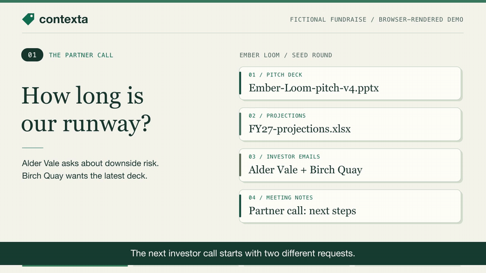

# contexta for Mac

Prepare for a seed-round meeting by bringing the runway figures, investor questions and next steps into one brief with dates and sources.



[Watch the investor meeting demo (MP4, English open captions)](demo/contexta-investor-demo.mp4)

In the fictional Ember Loom seed round, five sources shape the brief. Alder Vale asks about downside runway: the FY27 projections XLSX workbook shows 18 months in the base case and 12 months in the downside case. Birch Quay’s separate email asks for the latest pitch deck; contexta lists its filename and date without reading the slides. The meeting note calls for a revised model before Tuesday.

Both the GIF and MP4 have English open captions. The bundled app UI runs in Chromium with a simulated Mac host. This is not a macOS screen recording. The draft stays local: no real investor data, live AI session or message sent.

**[Download for Mac · Mac용 앱 다운로드 (ZIP)](https://github.com/zakat9/context-macos/releases/download/v0.12.3/contexta-0.12.3-macOS-arm64-adhoc.zip)** · [SHA-256 checksums](https://github.com/zakat9/context-macos/releases/download/v0.12.3/SHA256SUMS.txt) · [Product page &amp; help](https://zakat9.github.io/context-macos/) · [한국어 안내](https://zakat9.github.io/context-macos/#ko) · [Release notes](https://github.com/zakat9/context-macos/releases/tag/v0.12.3)

**Apple silicon only · 0.12.3 prerelease · not Apple-notarized.**

Tag Apple Notes, Mail messages and saved files from the macOS menu bar. Look up a tag to copy current source material into an AI draft with its dates and citations. contexta never presses Send.

## Install and try it

1. Download the **app ZIP** above, unzip it and move **contexta.app** to Applications. Open the app and look for the tag icon in the menu bar.
2. Open a sample note. Click the tag icon → **App access**, select Notes and choose **Request selected**. When you return to the note, check the title under **Selected item**, type a tag such as `Quote` and press Return. Repeat for a related email or saved file. Each item can have up to two tags.
3. Under **Find context**, select `Quote`. Preview a source, untick anything you don't want, then press **Copy** and paste into your draft. No extension is required.

[Watch the investor meeting demo (20 seconds)](https://zakat9.github.io/context-macos/#investor-demo) · [Installation help](https://zakat9.github.io/context-macos/#help)

## Upgrading from Context 0.12.2

Upgrading from Context 0.12.2? Quit `Context.app`, install **contexta.app**, then open the new app once before removing the old one. Keep `~/WorkIndex/` in place to retain your tags and settings. Your existing shortcut stays the same. The app bundle ID, Chrome extension ID and helper ID have not changed.

If you use **Insert context**, opening contexta once updates the existing Chrome helper registration. Reload the extension in Chrome. If the helper still stops, open **Settings → Insert context** in contexta, turn it off and set it up again. Do not reopen the old app: it can point the helper back to itself.

## Features and limits

**0.12.3 prerelease (build 9).** The prebuilt app is for Apple silicon (M-series). The build targets macOS 12 or later. On macOS 27.2.1, 54/54 native self-tests passed. The upgrade was tested with temporary folders, not a real user profile or a live ChatGPT session. It is ad-hoc signed, not Apple-notarized; Gatekeeper may block it. No Intel binary is provided.

- **Tag current item:** assign a shortcut in Settings to open the editor for the selected item.
- **Manage tags:** preview the number of affected sources before renaming or merging a tag. Originals are never edited.
- **Insert context:** the optional Chrome extension inserts sources into a ChatGPT draft. Tested on a fictional chat page, not the live ChatGPT editor. For any other AI app, use Copy and paste.
- **File support:** reads saved Excel cell values, plain text and saved mail; PDF, Word, PowerPoint and iWork documents are taggable by name and date only. Files over 40 MB are listed, not read.
- **Synced files:** In Finder, select a file stored locally by Google Drive, Dropbox, OneDrive, Box or iCloud Drive. This includes provider folders under `~/Library/CloudStorage/`. contexta reads supported formats just as it does other local files. Citations show the service and folder, not the account folder. Online-only files and Google Docs links can be tagged by name and date; contexta does not read their contents or download them. Tests used fictional paths, not a real cloud folder or online-only file.
- **App icon and menu:** Look for the teal tag on contexta.app. The menu bar keeps its original tag symbol. The menu stays 352 points wide, grows or shrinks with its contents, and scrolls when the list is too tall for the screen.
- **Privacy:** contexta keeps a local index under `~/WorkIndex/`, not copies of document contents or version history. The app makes no network requests. Review what you copy or insert before sending it to another service.

## Build from source

Install Apple's Command Line Tools. Use the [versioned source ZIP](https://github.com/zakat9/context-macos/releases/download/v0.12.3/contexta-0.12.3-source.zip) for the exact prerelease source. From the project root:

```bash
cd app
bash build.sh install
open ~/Applications/contexta.app
```

The script runs the Mac self-test and installs to your user Applications folder. To run the fictional-data regression suite, use `node tests/run.js` from the project root (Node 18+). See [release notes](https://github.com/zakat9/context-macos/releases/tag/v0.12.3) and [remaining live checks](LIVE-CHECKS.md) for the tested scope. GitHub's **Code → Download ZIP** gives repository files, not an installable app.

## Help and removal

- **Permission denied?** Review **System Settings → Privacy & Security → Automation**. Select one saved item and try again. Do not disable Gatekeeper.
- **Shortcut or insertion not working?** Check the shortcut in Settings, or use the tag icon and Copy. [Report an issue](https://github.com/zakat9/context-macos/issues) with the app version, macOS version and fictional reproduction steps. Do not include personal files or mail.
- **Uninstall:** disable Insert context in Settings if enabled and remove its Chrome extension. Quit the app and delete contexta.app. Keep `~/WorkIndex/` to retain your local tags.

## 한국어 빠른 시작

**[Apple Silicon용 앱 ZIP 다운로드](https://github.com/zakat9/context-macos/releases/download/v0.12.3/contexta-0.12.3-macOS-arm64-adhoc.zip)** · [소스 ZIP](https://github.com/zakat9/context-macos/releases/download/v0.12.3/contexta-0.12.3-source.zip) · [SHA-256 체크섬](https://github.com/zakat9/context-macos/releases/download/v0.12.3/SHA256SUMS.txt) · [투자사 미팅 준비 데모 보기](https://zakat9.github.io/context-macos/#demo-ko)

기존 Context 0.12.2에서 업데이트할 때는 `Context.app`을 종료하고 **contexta.app**을 설치하세요. 새 앱을 한 번 연 뒤 기존 앱을 삭제하세요. 태그와 설정을 보관하는 `~/WorkIndex/`는 그대로 두세요. 앱, Chrome 확장 프로그램, 도우미의 ID와 기존 단축키는 바뀌지 않았습니다.

**Insert context** 사용자라면 새 앱을 한 번 열어 기존 Chrome 도우미의 경로를 갱신한 뒤, Chrome에서 확장 프로그램을 다시 로드하세요. 도우미가 계속 멈추면 contexta의 **Settings → Insert context**에서 기능을 끄고 다시 설정하세요. 예전 앱을 다시 열면 도우미가 이전 경로를 가리킬 수 있습니다.

0.12.3 프리릴리스(빌드 9)는 Apple Silicon(M 시리즈)용이며 macOS 12 이상을 대상으로 빌드했습니다. macOS 27.2.1에서 자체 테스트 54/54개를 통과했습니다. 업그레이드는 임시 폴더에서만 테스트했으며 실제 사용자 프로필과 실제 ChatGPT 환경에서는 검증하지 않았습니다. ad-hoc 서명만 있으며 Apple 공증은 받지 않았습니다. Gatekeeper가 실행을 차단할 수 있습니다. Gatekeeper를 끄지 마세요.

압축을 풀고 contexta.app을 응용 프로그램 폴더로 옮기세요. 메뉴 막대의 태그 아이콘에서 Notes 접근을 허용한 뒤, 메모와 관련 메일에 같은 태그를 붙이세요. **Find context → Copy**로 필요한 자료만 출처와 함께 복사할 수 있습니다. 전송은 사용자가 직접 합니다.

Finder에서 선택한 동기화 파일은 Mac에 저장된 경우에만 지원 형식의 내용을 읽습니다. 온라인 전용 파일은 이름과 날짜로만 태그하며 내려받지 않습니다. 실제 클라우드 폴더나 온라인 전용 파일로는 테스트하지 않았습니다. 앱 아이콘은 청록색 태그로 바뀌었고, 메뉴 막대의 태그 기호는 그대로입니다. 메뉴 창 높이는 내용에 맞춰 바뀌며 긴 목록은 스크롤할 수 있습니다.

## License

All rights reserved. No open-source license has been granted.
